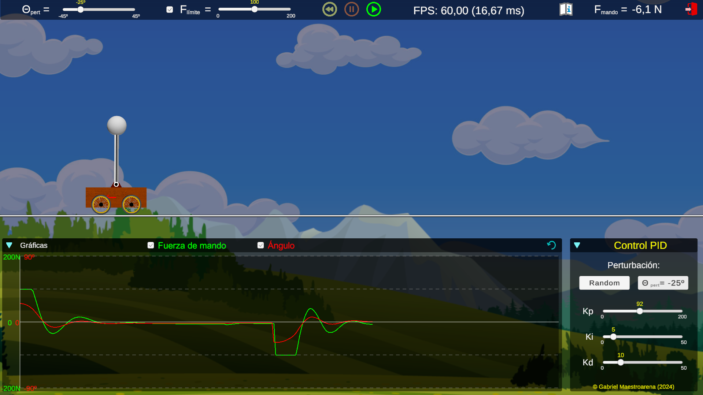

# InvertedPendulum
Control PID para controlar un Péndulo Invertido. Simulado con el motor de físicas de **Unity**.

## Estado
En progreso. Implementado nivel básico de simulación. Gráficas de Ángulo y Fuerza de Mando. 

## Descripción
Simulación de péndulo invertido. No se utilizan ecuaciones. Se simula el entorno físico (utilizando motor de físicas de **Unity**).
El Control para gestionar el péndulo es un Control PID con parámetros **Kp**, **Ki** y **Kd**.
No se ha realizado un diseño para calcular los parámetros, tan sólo se ha definido un intervalo de trabajo de cada uno de ellos y, empíricamente se estudia si la respuesta del control a perturbaciones reacciona de una forma estable o no.

En esta primera versión se han incluido las siguientes opciones:\
      - Posibilidad de añadir perturbaciones (fijas o aleatorias dentro de unos rangos razonables)\
      - Posibilidad de limitar la variable de mando (Fmando) para que no supere un umbral (en valor absoluto)\
      - Modificación de los parámetros de control (Kp, Ki y Kd) en tiempo de ejecución

Se incluyen gráficas de respuesta temporal para analizar en todo momento el ángulo de la barra del péndulo con eje vertical, así como el valor de la Fuerza de Mando (Fmando). Son seleccionables las variables a mostrar en el panel de gráficas.

La simulación permite dos estados:\
      - **PLAY:** se simula el carro con el péndulo invertido con todas las fuerzas que actúan sobre él, incluyendo las reacciones de las articulaciones, peo de carro y barra, fuerzas de rozamiento al deslizamiento y resistencia lineal y angular del aire, normales, etc...\
      - **PAUSE:** se detienen las físicas y la captura de datos, por si se quiere analizar un instante determinado.

Existe la posibilidad de reiniciar el escenario de simulación con los parámetros por defecto y la inclinación inicial de la barra.

Existe un pequeño manual guía del funcionamiento de la simulación y algunos ejemplos para practicar.
